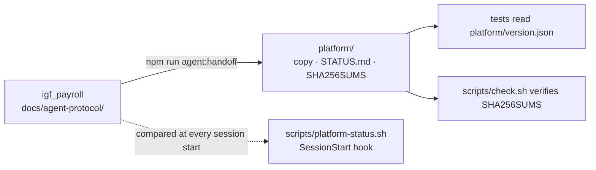

# Architecture

## Summary

One agent per Windows server — every SQL Server instance on it —, hosting N bindings; each binding links one Sage database (on the instance it names) to one
ERP connection of one société on the platform, and talks to the platform as that binding only.
**Built (Phases 5–8, 2026-10-17): pairing, the bindings and their verbs, one loop per binding, the sync
of the chart of accounts — end to end on Linux in Docker, every failure case included —; the Windows
package (the zip ran on the user's Windows Server 2025: paired over the WAN, synced); the MSI, the
signing step (off), bindings from a JSON file the service consumes, Windows authentication.** The MSI has
not been installed on Windows yet. Not built: the download and the updates (Phase 9).

## The binding model (built)

```mermaid
flowchart LR
    subgraph Server["Serveur de l'hébergeur — une instance SQL Server"]
        A[PayrollSageAgent — un service Windows]
        A --- B1[binding A<br/>base ClientA · login SQL A · jeton A]
        A --- B2[binding B<br/>base ClientB · login SQL B · jeton B]
    end
    B1 -->|HTTP(S) sortant| P1[Société A · connexion Sage]
    B2 -->|HTTP(S) sortant| P2[Société B · connexion Sage]
```

The rules behind it are the contract's (`platform/protocol.md` › « Identity: the binding »): one
token per binding, one SQL login per binding (any that reads `F_COMPTEG`, `sa` included — read-only and dedicated is the recommendation), no list of databases ever leaves the server,
the ERP's credentials never reach the platform.

## The projects (built)

| Project | Holds today | Will hold |
| --- | --- | --- |
| `PayrollSageAgent.Core` | the contract's records (`Contract/`), the platform client (`Platform/`), the binding model (`Bindings/`), `JobRunner` and `BindingLoop` (`Jobs/`), `AgentProtocol` | write jobs (écritures into Sage) — a later slice |
| `PayrollSageAgent.Sage` | `SageChartReader`: F_COMPTEG (the code only reads), the login check, SQL Server's errors in French with their detail | Compte tiers, when the contract asks |
| `PayrollSageAgent.Service` | the host and `AgentSupervisor` (one loop per binding, and `pending\` at every pass), the verbs (`Cli/AgentCli`), the pairing both run (`BindingPairing`), `PendingRequests`, `BindingStore`, the secret protectors (DPAPI; a dev stand-in), the restricted folder (`AgentHome`) — and, outside it, `installer/`, `scripts/package.sh`, `scripts/lib/installers.py` (the MSI), `scripts/sign.sh` | self-update (Phase 9) |
| `PayrollSageAgent.Core.Tests` | 69 tests: the `pending\` request format — one binding or several sharing values — and old binding files, the console copied into the log, the log files, the service SID, the address an agent may follow, and every fixture of `platform/fixtures/` round-tripped, every schema message mapped, the runner's rules, the client against a stub, the loop's isolation and its clean logs | — |

`Service → Sage → Core`, and `Core` depends on nothing.

## The link to the platform (built)



`igf_payroll`'s precheck refuses a contract change that was not frozen with a version and an
« Agent impact »; the handoff copies it here; the hook tells the Claude session of this repo, at
start, whether the platform moved. Details: `.claude/rules/platform-contract.md`.
