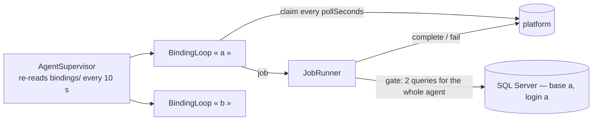

# Bindings and verbs

## Summary

A **binding** is one Sage database linked to one ERP connection of one société on the platform. The
agent keeps each one as a file in its home and runs one loop per active binding. The IT person manages
them with three verbs of the same executable. Built in Phase 5 (2026-10-17) and run on this Linux
machine in Docker; **never run on Windows yet** (Phase 7).

## The verbs

```
PayrollSageAgent add-binding --name <nom> --url <adresse> --code XXXX-XXXX-XXXX
                             --sql-server <serveur> --database <base> (--sql-user <compte> | --windows-auth)
                             [--trust-server-certificate] [--sql-password-stdin]
PayrollSageAgent add-binding --config <fichier.json> [--sql-password-stdin]
PayrollSageAgent remove-binding --name <nom>
PayrollSageAgent check-sql --sql-server <serveur> --database <base> (--sql-user <compte> | --windows-auth) [--trust-server-certificate]
PayrollSageAgent check-sql --name <nom>  |  --config <fichier.json>
PayrollSageAgent list-bindings
PayrollSageAgent update [--now]          — from the runner copy only (the task, Mettre-a-jour-agent.bat)
PayrollSageAgent help
```

`update` is the self-update — `03-windows/installation.md` › « Updates ». The MSI's own steps
(`configure-service`, `init-config`, `purge`), `apply-config` and `set-label` are in the same chapter.

**`add-binding`**, in order — each step stops with a French sentence and an exit code:

| Step | Refused when | Exit |
| --- | --- | --- |
| the arguments | a name that is not `[a-z0-9-]` (≤ 40), a name already used, an address that is not `http://` or `https://`, a code not of the form `XXXX-XXXX-XXXX` | 2 |
| the SQL password | given as an argument — it is read from a hidden prompt, or from stdin with `--sql-password-stdin` | 2 |
| the agent's folder | this console may not write it (on Windows: not run as administrator) — asked BEFORE pairing, so no code is spent | 6 |
| the login check (`SageChartReader.CheckAsync`) | the login cannot connect or cannot read `dbo.F_COMPTEG` — the sentence says what to look at, SQL Server's own error follows on a « Détail : » line. A login that can also WRITE, or see every database (`sa`), is accepted and said (« [i] … ») | 3 |
| pairing (`POST /pair`) | the platform refuses the code — one answer for unknown, expired or used | 4 |
| the address returned | it points INWARD — back at this server, or private while the platform was reached at a public address (`AgentAddress.MayFollow`): the pairing is undone at once | 4 |
| — | the platform cannot be reached | 5 |
| Windows authentication | the service did not pick the request up within 25 s (not running) | 7 |

**One implementation, two callers** (`Bindings/BindingPairing`): the verbs at the console, and the
SERVICE for a request dropped into `pending\` (`Bindings/PendingRequests` — the format is
`PendingRequest`, in Core, with its tests). **Windows authentication always goes through the service**:
its check must run as the identity that will read Sage, so the verb writes the request into
`pending\`, waits, and prints the service's answer. `add-binding --config` reads a request file at the
console; a password the file lacks is asked at the prompt, and a file that holds one is told to be
deleted (the service deletes what it reads from `pending\`; a `--config` file is the user's).

**Several bindings in one file** — a hosting company's server, one database per client, on one or
several SQL Server instances: shared values at the top (`url`, `sql`), a `bindings` list with each
binding's own `name`, `code` and `sql` overriding them (`exemple-plusieurs-liaisons.json`). A binding
that declares `"auth": "windows"` itself does not inherit the shared login. **The file is checked whole
first** — one malformed binding and nothing is done, every problem said at once — **then each binding
on its own**: a code expired or a login refused stops only that one. The service's answer has a
`bindings` list (name, ok, exit code) and the lines under a « — nom — » header each; `--config` does the
same at the console, with ONE stdin line per binding that needs a password, in the file's order. The exit
code is the first failure's, 0 when all succeeded.

**`set-label --label « … »`** (Windows, administrator) changes the name services.msc shows, and saves it
where the next MSI reads it back; the service name stays `PayrollSageAgent`. One agent covers every SQL
Server instance of its server — each binding names its own — so the label is for telling servers apart.

**`agent.json` — the agent's config, the way IT works without a console**: in the agent's folder
(`%ProgramFiles%\IGF\PayrollSageAgent`), opened by `Configurer-agent.bat`, applied by
`Redemarrer-agent.bat` (= `apply-config --restart`). It is the DESIRED STATE (`ConfigApplier`): absent +
code → paired; linked + new code → paired again, the new saved first; linked, a password or a setting
changed → checked, updated, the service restarted; `"remove": true` → unlinked and gone from the file;
absent without a code → refused; a binding the file does not name → left alone. Then the secrets of what
worked leave the file (code « "" », password « (protégé) »), and `agent.result.txt` says it all.

**`accountFilter` (0.6.0, contract step 12) — which comptes généraux a binding syncs.** At the top of
`agent.json` (shared) and/or in a binding's entry (its own list wins; `[]` is no filter), also in a
`pending\` / `--config` file: `"accountFilter": ["4%", "50%"]`. SQL's `LIKE` — `4%` starts with 4, `%62` ends
with 62, `%62%` contains 62, `421100` is that one account — restricted to letters, digits, `%` and `_`, 40
characters, 50 patterns (`AccountFilter`); anything else refuses the whole file, because the platform
matches the SAME patterns to delete what lies outside them. Kept in the binding file
(`BindingConfig.AccountFilter`; a file from before 0.6.0 has none and reads as the whole chart). A change of
filter alone is saved without a SQL check and the service restarted. `SageChartReader` reads
`WHERE LTRIM(RTRIM(CG_Num)) LIKE @p0 OR …` — parameters, never pasted text — and `JobRunner` sends the
patterns in `result.accountFilter` (no key without a filter: a platform older than the filter refuses it). A
filter that matches nothing fails the job (`source_invalid`, not retried) and sends nothing. **On the
platform, the next sync DELETES the accounts of that ERP outside the filter**, except those a mapping
uses (kept and named); the log line says how many. `list-bindings` shows a binding's filter.
**[!] An agent older than 0.6.0 refuses the key** (« clé inconnue ») and applies nothing: update first.

**`partnerFilter` (0.7.0, contract step 13) — which comptes tiers a binding syncs**, beside `accountFilter`
and in every way like it: shared at the top and/or per binding (its own list wins, `[]` is no filter, each
key inherited on its own), the same grammar and checks, kept in the binding file
(`BindingConfig.PartnerFilter`; a file from before 0.7.0 reads as every tiers), a change of it alone saved
without a SQL check. It serves the second job type, `sync_partner_accounts`: `SageChartReader` reads
`F_COMPTET` (`CT_Num`, `CT_Intitule`, `CT_Sommeil`, `CT_Type`, `WHERE LTRIM(RTRIM(CT_Num)) LIKE @p0 OR …`),
and `JobRunner` sends the patterns in the SAME `result.accountFilter` field — one result shape for both
types. Without a filter EVERY tiers comes, clients included; more than 10 000 fails with a sentence that
suggests a `partnerFilter`. On the platform, the tiers outside it are deleted unless a salarié is linked to
them or a rubrique names them. `list-bindings` shows « tiers SAL% ». **[!] An agent older than 0.7.0
refuses the key** and fails a `sync_partner_accounts` job (« mettez-le à jour »): update first.
**`init-config --msi <chemin>`** is the MSI's: an empty `agent.json` on a first install, the existing one
kept, or the one placed next to the MSI taken and applied. **`configure-service`** (also the MSI's) runs the `sc.exe`
settings: delayed start, service SID, restart on failure.

**`purge --confirm`** is the MSI's: on a real uninstall it unpairs and deletes every binding and every
request; the logs stay. Not in `help` — nobody needs to type it.

**`check-sql`** is the login check alone — no code, nothing written — for finding the right server name,
port or protocol without a code expiring between tries; `check-sql --name` re-checks a binding's own
login with its stored password. **Every verb's output is also written to the log file**, preceded by the
command line with its pairing code masked, and followed by its exit code.

**HTTP is accepted to any host for now** (the user's decision, 2026-10-17) — `add-binding` warns that the
code, the token and the chart then cross the network in clear.

Then the binding file is written, with the address the platform returned (`endpoint`) and both secrets
protected; the running service picks it up within 10 seconds. `--trust-server-certificate` skips the
SQL Server certificate check and says so: a test server only.

**`remove-binding`** tells the platform first (`POST /unpair`, best effort — it says when the platform
could not be told, and the binding should then be revoked from the platform's screen), then deletes
the file and its secrets. **`list-bindings`** prints name, state, database, société — connexion and
address; never a secret.

## The binding file

`bindings/<name>.json` in the agent's home (`%ProgramData%\IGF\PayrollSageAgent` on Windows,
`PAYROLL_AGENT_HOME` to override). One file is the whole binding: name, `endpoint`, `bindingId`, the
société and connexion names, the SQL target (server, database, login, certificate choice), the paired
date, its state — `active`, or `revoked` once the platform answered `token_invalid` — and the two
protected secrets. Written atomically, owner-only on Unix. How the secrets are protected:
`.claude/rules/secrets-and-logging.md`.

## The loop



- **Claim is the heartbeat**; the platform says how often (`pollSeconds`, 15 s).
- **Network or 5xx**: backoff from 5 s doubling to 5 minutes, with jitter. **426 `protocol_unsupported`**:
  logged, retried hourly. **426 `agent_outdated`** (the build below the platform's minimum): logged once,
  retried every 5 minutes — the screen still sees the agent — while the updater installs the latest.
  **401 `token_invalid`**: the binding is marked `revoked` in its file and its loop ends.
- **Every answer** tells the supervisor the platform was reached, which it writes into `health.json`
  (at once the first time, then every 30 s at most): what the updater waits for after an install.
- **A job's outcome** is delivered up to three times within the lease; past it, the platform hands the
  job out again and the next claim runs it anew.
- **The agent decides nothing about the data**: it sends what `F_COMPTEG` holds (numbers and labels
  trimmed, an empty label as `null`) and the platform applies its rules. It refuses only what the
  contract cannot carry — more than 10 000 accounts, a number twice — as `source_invalid`.

## What the log says

One French line per event, naming the binding by its local name and counting, never carrying a token,
a password, a code or an account. The lines an IT person will read:

| Event | Line |
| --- | --- |
| a binding starts | « à l'écoute de la plateforme pour « Sage … ». » |
| a sync | « plan comptable envoyé — 1348 comptes ; … créés, … mis à jour, … ignorés par la plateforme. » |
| a failure reported | « échec signalé à la plateforme (sql_unreachable) — un nouvel essai est possible. » |
| revoked on the platform | « révoquée ou inconnue de la plateforme. Elle est arrêtée ; refaites l'appairage pour la relier. » |
| platform moved on | « cet agent parle le protocole 0, la plateforme sert 1 à 1. Mettez l'agent à jour ; nouvel essai dans une heure. » |
| the bindings folder unreadable | « Lecture des liaisons impossible (…) ; nouvel essai toutes les 10 secondes. » — once, until it reads again |
| shutdown | « Arrêt de l'agent demandé. », then « Arrêt signalé à la plateforme : 1 liaison(s) sur 1. » |
| a stop the platform did not hear | « l'arrêt n'a pas pu être signalé (…) ; la plateforme la verra hors ligne après 45 s de silence. » |

**When the service stops, it says so (0.5.1, contract step 11).** It ends every binding's loop first,
then calls `POST /offline` for each binding it was running — not for one the platform revoked meanwhile —
all at once, 5 s at most for all of them, never retried (`OfflineNotice`). The platform shows the binding
« Hors ligne » at once, « Service arrêté sur le serveur », instead of « En ligne » for up to two minutes; the
next call puts it back « En ligne ». The order is load-bearing: a claim still in flight that landed after
the notice would make a stopped service look online again. A crash or a power cut says nothing, and the
platform's 45 s of silence decide. **[!] The first version filtered on « loops not yet completed » and
told the platform nothing**: the loops share the stopping token and have usually ended by the time the
supervisor's cleanup runs — the unit tests passed, Docker showed it. Revoked bindings are tracked by id.

On Windows those lines go to `logs\agent-AAAA-MM-JJ.log` (one per day, 30 kept) as well as the console —
`03-windows/installation.md`.

## Measured end to end (2026-10-17)

Two bindings on one SQL Server 2019 instance (`PRESTIGE_TEXTILE` / `agent_a` → IGF,
`PRESTIGE_TEXTILE_B` / `agent_b` → DEMO): 1 348 accounts each, synced at the same time; a second sync
1 348 unchanged; `sa` refused by the check; a reused code refused by the platform; a revocation on the
platform stopping its loop; `remove-binding` unpairing while the service ran; no token, no password and
no account number in the service's log.

**Phase 6, the same day, with the platform's screen in a browser** — every failure case of the plan
(`platform/plan.md` › Phase 6, the table there): a wrong and an expired code, a revocation, the agent
stopped (« Hors ligne »; a sync asked meanwhile ran 11 s after it came back), SQL Server stopped (three
attempts, then a sentence; stopped only for the first attempt, the retry completes), odd Sage rows, a
second sync, and a platform raised to protocol v1 (the agent says so and waits an hour). Also measured:
**a DBA killing the agent's pooled SQL session costs nothing** — the next sync connects again, first
attempt; and a revoked binding is not started again when the service restarts.

**The stop, measured 2026-10-18 (0.5.1, Docker, CLI stack):** `docker stop` returned in 0.18 s; the
platform read the binding « Hors ligne », stopped, 0 s since its last contact, the same instant; started
again, « En ligne » at its first claim; stopped again, « Hors ligne ». Not measured on Windows: a service
stop through the SCM and a server shutdown, where Windows gives the service only a few seconds.
