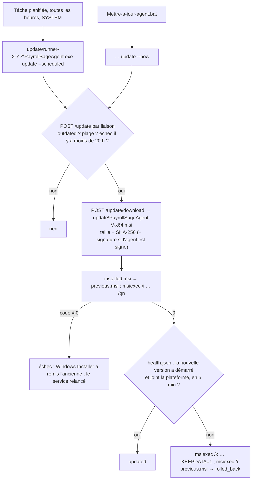
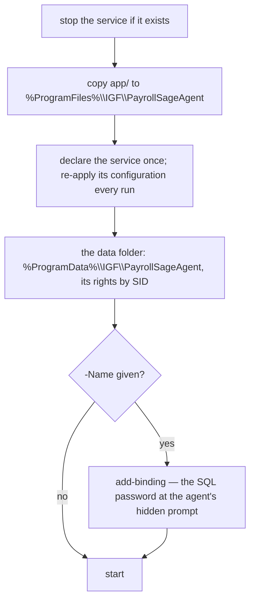

# Installing on Windows

## Summary

Each version ships as **an MSI** — `PayrollSageAgent-<v>-x64.msi`, the recommended installer — and **a
zip**, the dev fallback with `install.ps1` / `uninstall.ps1`, plus a release file saying whether they are
signed. All of it is built on Linux by `scripts/package.sh`: a self-contained Windows executable (no
.NET to install), a SQL script for a dedicated read-only login (recommended, not required — any login
that reads `F_COMPTEG` is accepted, `sa` included), one for Windows authentication, an example request
file, and a French guide for the customer's IT (`LISEZMOI.txt`). Built in Phases 7–8 (2026-10-17); the
agent UPDATES ITSELF since 0.5.0 (Phase 9, 2026-10-18 — « Updates » below). The zip (0.2.x), then the MSI
(0.4.1), have run on the user's Windows Server 2025 — 0.4.1 online over the WAN on 2026-10-18; **the
self-update has not run on Windows yet**.

## The deliverables

```
dist/
  PayrollSageAgent-0.5.0-x64.msi            the installer: service, rights, upgrade, uninstall, the update task
  PayrollSageAgent-0.5.0-win-x64.zip        app/ + install.ps1, uninstall.ps1 + the texts
  PayrollSageAgent-0.5.0.release.json       version, protocol, signed, label, each file's SHA-256
  *.sha256
```

The MSI installs `app/` (the exe, `Microsoft.Data.SqlClient.SNI.dll`, `msalruntime.dll` — brought by
SqlClient, unused —, `appsettings.json`) and the texts into `%ProgramFiles%\IGF\PayrollSageAgent`. The
release file is the agent repo's build output; the PLATFORM publishes it — igf_payroll's
`npm run agent:publish -- --stack=self --version=X.Y.Z --yes` reads it, checks the MSI against it and puts
both in the platform's `agent-releases` bucket and `sys_agent_releases` table. From then on the agents
update themselves to it, and the platform's Agent Sage screen offers it for download.

## The MSI — what it does, and how it is built

| Setting | Value | How |
| --- | --- | --- |
| service | `PayrollSageAgent`, « IGF Paie - Agent Sage », automatic, under `NT SERVICE\PayrollSageAgent`; started at install, stopped and removed at uninstall | wixl: `ServiceInstall`, `ServiceControl` |
| delayed start, service SID, « a stop with an error is a failure », restart after 1 min, 1 min, 5 min — and the update task | as `install.ps1` — its `sc.exe` commands; the task « \IGF\PayrollSageAgent-MiseAJour » (hourly, SYSTEM) on a runner copy of the exe | added: `configure-service`, the agent as SYSTEM between `InstallServices` and `StartServices` (never fails the install) |
| data folder `%ProgramData%\IGF\PayrollSageAgent` | protected; SYSTEM, Administrators full, the service's SID modify | added: `MsiLockPermissionsEx` (SDDL) |
| upgrade | a newer MSI removes the old product INSIDE its own transaction, so a failed upgrade is rolled back to the version before; `%ProgramData%` — the bindings — stays | wixl: `MajorUpgrade`, the permanent upgrade code; `RemoveExistingProducts` moved to InstallInitialize + 1 (0.5.0 — wixl put it after InstallValidate, where a failure leaves NEITHER version) |
| `agent.json`, the config | created empty in the agent's folder on a first install, kept on an update; one placed next to the MSI becomes it and is applied at once; the MSI itself kept as `update\installed.msi`, for a rollback | added: `init-config --msi "[OriginalDatabase]"` as SYSTEM after `StartServices` (never fails the install) |
| uninstall | every binding unpaired and deleted with its secrets, the task and the update folder removed; the logs stay. `KEEPDATA=1` keeps it all — the updater's rollback | added: `purge --confirm` as SYSTEM, `REMOVE~="ALL" AND NOT UPGRADINGPRODUCTCODE AND NOT KEEPDATA` |
| `InstalledBy = msi` | `HKLM\SOFTWARE\IGF\PayrollSageAgent` | so `install.ps1` / `uninstall.ps1` refuse to touch it |
| the services.msc label | `AGENTLABEL="…"` on the command line, else the saved one (`Label`, read before the old version goes), else « IGF Paie - Agent Sage » | added: `RegLocator` + `AppSearch` into `AGENTLABEL_SAVED`, two type-51 actions at 51–52; `ServiceInstall.DisplayName = [AGENTLABEL]` |

**wixl 0.103 refuses** `ServiceConfig`, `ServiceConfigFailureActions` and `PermissionEx`, and ignores
`Hidden` and `Platform` (measured). The folder's rights are Windows Installer's own `MsiLockPermissionsEx`,
imported with `msibuild`. The service's configuration was first its tables too (`MsiServiceConfig`,
`MsiServiceConfigFailureActions`, applied by `MsiConfigureServices`): **on the user's Windows Server 2025
that failed with error 1939 and rolled the install back (0.3.1)**. Since 0.3.2 it is the agent itself,
`configure-service`, running the `sc.exe` commands `install.ps1` had run successfully on that server.
`installers.py` **asserts every table and action** — a missing row fails the build. The agent's own steps
run the exe by its path (custom action type 34): as type 18 — « the exe from the File table » — Windows
Installer refused them with error 2753 on the user's server, on uninstall and on an install over an exe
already in place (0.4.0); 0.4.1 changed them, and the build refuses a type-18 action. **`agent.json`, in the agent's folder, is the config** (0.4.0, the user's design): the MSI installs and
starts the service and creates it empty; IT fills it (`Configurer-agent.bat`, Notepad elevated) and
applies it (`Redemarrer-agent.bat`: apply, restart, show the answer — also in `agent.result.txt`). Its
secrets leave it once applied. Measured on Linux with the exact commands: the empty file created; two
databases linked and their secrets taken out; a re-apply unchanged; a password changed, a `remove`, a new
entry without a code refused and a Windows-auth one handed to the service, in one apply; an `agent.json`
next to the « MSI » taken and applied, its report written there.

**Moving a zip install to the MSI**: `uninstall.ps1 -KeepData` (the service and the program go, the
bindings, secrets and logs stay), then the MSI, which takes them as they are.

## Updates — the agent replaces itself (0.5.0, Phase 9)

`platform/protocol.md` › « Updates » is the contract; this is how the agent keeps it.



- **The updater is the same exe**, `update`, but run from a COPY: `configure-service` copies the exe into
  `update\runner-<version>\` at every install and registers the task on it — an install replaces the
  program's own exe, which a running process would lock (a reboot to finish). `Mettre-a-jour-agent.bat`
  reads `update\runner.txt` and starts the same copy with `--now`; `update` from the installed exe is
  refused. The runner of the version before keeps running the install it started, from its own folder.
- **The update folder is under Program Files** (`%ProgramFiles%\IGF\PayrollSageAgent\update`): only
  SYSTEM and the Administrators write there — never the service's account, which may write its data
  folder: what SYSTEM installs must not be a file that account could plant. It holds `settings.json`
  (applied from `agent.json` › `update`), `state.json` (the last attempt), `installed.msi` / `previous.msi`,
  a verified download, the runner copies and `install-*.log`.
- **When**: `outdated` → at once (unless `"auto": false`); `"auto": true` and the server's clock inside
  `window` (one hour at least: the task runs hourly, each server at its own minute) → then; a person's
  `--now` → at once; a version that failed or was rolled back → not again for 20 hours (except `--now`).
- **Health**: the service writes `health.json` in its data folder — its version, when it started, when it
  last reached the platform. The updater keeps the new version only once that file says the new version
  started after the install AND reached the platform (when it has bindings). It only READS that file: a
  file the service account controls can trigger a rollback, never an install.
- **Signature**: an agent whose own exe is signed installs only an MSI signed (`signed: true`, a valid
  Authenticode chain, `WinVerifyTrust`) by the SAME subject; an unsigned agent checks size and SHA-256
  alone — over HTTP, as trustworthy as the network.
- **Reported**: every check sends the settings and the last attempt through each binding; an attempt is
  reported at once, then hourly. The platform shows it on the Agent Sage sheet.
- **`agent_outdated`** on a job route: the loop keeps the binding and calls again every 5 minutes (the
  screen still sees it); the updater installs at its next run.

**Proven here (2026-10-18)**, in Docker against igf_payroll's CLI stack: a 0.4.9 build told of 0.5.0,
the 39 MB MSI streamed and verified (byte-identical to `dist/`), stopping before the install
(`DevelopmentUpdateMachine`: Windows only); 0.5.0 as the minimum — the service's claim refused and
logged, the updater installing out of its window; `health.json` written. The decision, the download's
checks, the install, the health wait, the rollback and the reports are unit-tested through a fake
`IUpdateMachine`. **Not run anywhere**: `WindowsUpdateMachine` (msiexec, the service, WinVerifyTrust) and
`UpdateTask` (schtasks, the runner copy) — Windows only.

## Signing

`scripts/sign.sh` is the ONE signing step, OFF unless `SIGNING_ENABLED=1`. Off, it prints
« NON SIGNÉ » for each file and the release file says `"signed": false` and « Version de développement,
non signée ». On, it signs the exe BEFORE it goes into the MSI, then the MSI:

```bash
SIGNING_ENABLED=1 SIGNING_DIR=/chemin/vers/certificat scripts/package.sh   # signing.pfx + signing.password
SIGNING_ENABLED=1 SIGNER=command SIGNING_COMMAND='jsign … "$1"' scripts/package.sh   # a token, a cloud key
```

`SIGNING_TIMESTAMP_URL` adds an RFC 3161 timestamp. Measured with a throwaway self-signed certificate:
both signatures verify. A real certificate is the gate before the first external customer (O5).

## A binding from a file — `pending\`

IT drops a JSON file (`exemple-liaison.json` for one binding, `exemple-plusieurs-liaisons.json` for
several sharing a server) into
`%ProgramData%\IGF\PayrollSageAgent\pending\`. The SERVICE, at its next pass (10 s): reads it, **deletes
it at once** — it may hold the pairing code and a SQL password —, checks SQL under its own identity,
pairs, protects the secrets, and answers in `<nom>.result.json` and the log. One attempt per file. A
malformed file is refused with what to fix (« une barre oblique inverse s'écrit deux fois »).
`add-binding --config <fichier>` reads the same file at the console and asks a password the file does
not hold — the way to keep the password out of every file.

## Windows authentication

`"auth": "windows"` / `--windows-auth`: no password exists. The service signs in as
`NT SERVICE\PayrollSageAgent` on its own machine, as the machine account `DOMAINE\SERVEUR$` towards
another server of a domain (`acces-windows.sql` grants either); across machines OUTSIDE a domain it
cannot (« SSPI » — the sentence says to use a SQL login). Because the check must run as the service, a
verb hands it over through `pending\` and prints the service's answer — or exit 7 if the service does not
pick it up within 25 s. Every binding of one agent shares that identity.

## The zip's `install.ps1`

Run as administrator; re-run from a newer zip, it is the UPDATE (bindings kept).



| Setting | Value | Why |
| --- | --- | --- |
| name / display | `PayrollSageAgent` / « IGF Paie - Agent Sage » | `ServiceIdentity.Name` |
| account | `NT SERVICE\PayrollSageAgent` (virtual) | no password; no right but its folder — SQL logins, outbound calls |
| start | automatic, delayed | the network is up by then |
| recovery | restart after 1 min, 1 min, 5 min; reset after a day; `failureflag 1` | a stop with an error code counts too |
| SID type | unrestricted | the folder names the service's own SID |
| data folder rights | `*S-1-5-18` F, `*S-1-5-32-544` F, the service's SID M; inheritance removed; Users, Authenticated Users, Everyone removed | DPAPI is machine-scope: the folder is what keeps the secrets |

Accounts are named by SID because a French Windows says « Administrateurs ». The service's SID is
computed from its name — `S-1-5-80-` and the SHA-1 of the upper-cased name in UTF-16 — by both the
script (`Get-ServiceSid`) and the agent (`ServiceIdentity.Sid`, which `AgentHome.Ensure` uses when an
`add-binding` creates the folder before the installer ran). Both are checked against TrustedInstaller's
published SID.

## Logs

`%ProgramData%\IGF\PayrollSageAgent\logs\agent-AAAA-MM-JJ.log` — one file per day, 30 kept, removed by
the date in their name only. The service writes there, and so does every verb: its command line (the
pairing code masked), everything it printed, its exit code. One line per event (`2026-10-17 19:01:46 +00:00 [INF] BindingLoop :
Liaison « prestige » : plan comptable envoyé — 1348 comptes ; …`). No Event Log: writing there needs an
event source an administrator registers, the service account cannot, and a provider that throws takes
its caller down. The logs carry no token, password or account, which is why IT can send them; the
`bindings\` folder is never sent.

## When the SQL check fails

The first real server (2026-10-17, Windows Server 2025, SQL Server 2019, a named instance) answered
`add-binding` with « Le serveur SQL ne répond pas » — and nothing else, because the agent replaced SQL
Server's error with its sentence. Since 0.2.1 every refusal prints a « Détail : » line — SQL Server's own
number and text — and every verb's output goes to the log file too. `check-sql` runs the check alone,
with no code to expire. The sentences, measured on Linux against the test container:

| Case | Sentence (start) | Recognised by |
| --- | --- | --- |
| unknown instance | « L'instance SQL est introuvable … SQL Server Browser … SERVEUR,PORT » | SNI « error: 26 » |
| TCP refused | « SQL Server refuse la connexion réseau : le protocole TCP/IP est-il activé … » | SNI « error: 40 », n° 53 / 2 / 10061 / 1326 — Windows numbers, not measurable here |
| no answer while connecting | « SQL Server n'a pas répondu en 15 s … » | n° -2 / 258 / 10060 while CONNECTING |
| login | « Le compte SQL … est refusé (mot de passe, compte désactivé, ou authentification SQL Server non activée ?) » | n° 18456 |
| certificate, TLS | « … --trust-server-certificate », « … pas de version de TLS en commun » | AuthenticationException, SChannel numbers |

Anything else keeps « Le serveur SQL ne répond pas » — with the detail under it. A refused port on
Linux's managed network layer reports a generic « error: 35 », so that case reads that way here.

## The SQL Server certificate

The agent connects with `Encrypt=Mandatory`. Most Sage servers keep the self-signed certificate SQL
Server was installed with, which a Windows machine does not trust: `add-binding` then says so — « Le
certificat du serveur SQL n'est pas reconnu… Reliez avec --trust-server-certificate » — instead of
« ne répond pas » (`SageChartReader.IsCertificateRefused`; measured on Linux against the test
container, whose certificate is self-signed too). The flag is stored with the binding.

## LAN and WAN

The agent calls out and opens nothing, so a customer's server needs only outbound access to the
platform's agent address — over the LAN, or over the Internet. After pairing it follows the address
the platform returns (`PairResponse.endpoint`) **unless that address points inward**: back at this
server, or at a private address while the platform was reached at a public one, which at a customer's
is one of their own machines (`AgentAddress.MayFollow`). The pairing is then undone at once.

HTTP is accepted for now, to any host (the user's decision, 2026-10-17); `add-binding` warns that the
code, the token and the chart then cross the network in clear.

## Checking the package without Windows

```bash
scripts/package.sh                         # → the MSI (its tables asserted), the zip, the release file
file dist/PayrollSageAgent-*/app/PayrollSageAgent.exe     # PE32+ executable (console) x86-64
docker run --rm -v "$PWD/dist:/d:ro" payroll-agent-packaging:local msiinfo export /d/PayrollSageAgent-<version>-x64.msi ServiceInstall
docker run --rm -v "$PWD/installer/windows:/w:ro" mcr.microsoft.com/powershell:7.4-ubuntu-22.04 pwsh -NoProfile -Command '
  foreach ($f in "install.ps1", "uninstall.ps1") { $e = $null
    [System.Management.Automation.Language.Parser]::ParseFile("/w/$f", [ref]$null, [ref]$e) | Out-Null
    if ($e.Count) { $e } else { "$f : parses" } }'
```

That proves the syntax, the SID derivation and the MSI's TABLES — not Windows PowerShell 5.1's
behaviour, not that Windows Installer applies the tables, not the service.

## To verify on Windows

**The zip (0.2.x), on the user's Windows Server 2025, 2026-10-17:** installed, the SQL check through its
« Détail : » line, paired over the WAN, online, a first sync. Not run: reboot, revoke, uninstall (the user
closed Phase 7 on the WAN result).

**The MSI (0.4.1), 2026-10-17/18:** installed over the earlier attempts, paired again, online over the
WAN (the platform's binding, 0.4.1, last call seconds old on 2026-10-18).

**The self-update (0.5.0), still to do:** install 0.5.0 by hand (`msiexec /i … /l*v`) — then
`schtasks /Query /TN \IGF\PayrollSageAgent-MiseAJour /V` (hourly, SYSTEM, the runner path),
`dir "C:\Program Files\IGF\PayrollSageAgent\update"` (`installed.msi`, `runner-0.5.0\`, `runner.txt`),
the sheet showing « Automatiques, entre 03:00 et 05:00 » after the first hourly check; then 0.5.1
published: `Mettre-a-jour-agent.bat` installs it and says « Mise à jour faite », the sheet shows
« 0.5.1 installée »; a forced rollback (a 0.5.2 whose service cannot reach the platform) comes back to
0.5.1.

**0.5.1 is that next version, and it carries something to see (2026-10-18):** the service says it is
stopping (contract step 11, `01-agent/bindings-and-verbs.md`). On the server, `net stop PayrollSageAgent`
(or services.msc), then « Relire l'état » on the platform's ERPs row: « Hors ligne » at once, and the
« Agent Sage » sheet says « Service arrêté sur le serveur ». The log ends with « Arrêt signalé à la
plateforme : 1 liaison(s) sur 1. » A 0.4.1 or 0.5.0 says nothing when it stops: the platform shows it
« Hors ligne » after 45 s of silence instead.

**Still to check from the MSI's first list:** check
`sc qc PayrollSageAgent` (`NT SERVICE\PayrollSageAgent`, `AUTO_START (DELAYED)`), `sc qfailure
PayrollSageAgent` (three restarts), `sc qsidtype PayrollSageAgent` (UNRESTRICTED), and
`icacls %ProgramData%\IGF\PayrollSageAgent` (the three SIDs and nothing else); a binding through
`pending\`; Windows authentication for real; an upgrade to the next version (bindings kept); the
uninstall (bindings unpaired, logs kept).
