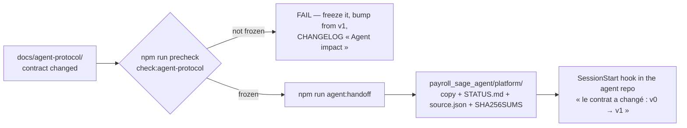

# The Sage agent contract

## Summary

This folder is the ONE place where the platform says what the on-premise agent
(`/home/igf/payroll_sage_agent`) may expect of it: the routes it calls, what it sends and receives,
the job types, the versioning, how the installer is distributed. The agent repo implements it and
never defines it. `.claude/rules/agent-protocol.md` is the working rule; this page says what is here.

| File | What it holds | Part of the CONTRACT hash |
| --- | --- | --- |
| `protocol.md` | the contract, in prose | yes |
| `version.json` | `protocol` (the version of this contract) and `minimumSupported` (the oldest agent protocol the platform still serves) | yes |
| `schema/agent-protocol.schema.json` | the machine-readable form — JSON Schema GENERATED from `packages/app-core/src/schemas/agent-protocol.ts` (the Zod objects the platform's router validates with) by `--freeze`; never edited | yes |
| `fixtures/<Message>[.<case>].json` | golden bodies, at least one per message — the check parses them, the agent's tests replay them | yes |
| `CHANGELOG.md` | one entry per version, each with its « Agent impact » | no — written as part of the change |
| `plan.md` | the step-by-step plan, from the empty repo to a real Sage database | no — its progress is STATUS, not contract |
| `protocol.lock.json` | GENERATED by `npm run check:agent-protocol -- --freeze`: the version and the hash last frozen | — |

## How the agent repo hears about a change

- **`npm run check:agent-protocol`** is in `precheck`. It asserts that the JSON Schema is what the Zod
  contract generates and that every fixture parses as its message, then hashes the contract files and
  compares them with `protocol.lock.json`. A changed contract that was not frozen fails, with the
  steps — and a change to the Zod file is a change to the contract, because it changes the schema.
- **`npm run check:agent-protocol -- --freeze`** regenerates the JSON Schema and records the new
  hash. It refuses unless the top entry of `CHANGELOG.md` is `## v<protocol>` and carries an
  « Agent impact » line. While `protocol`
  is 0 (draft, nothing ships) the version need not move; **from 1 on, a changed contract is a new
  version**.
- **`npm run agent:handoff`** copies this folder into the agent repo's `platform/` (wiped and
  rewritten) with a generated `STATUS.md`, `source.json` and `SHA256SUMS`. It refuses a contract that
  is not frozen, and a target that does not carry the marker `.payroll-agent-repo`. The target is
  `AGENT_REPO`, else `../payroll_sage_agent`. `--status` compares without writing.
- **In the agent repo**, `scripts/platform-status.sh` runs at every session start and puts one
  short note in Claude's context: in sync, the contract moved, only the plan moved, `platform/` was
  edited by hand, or `igf_payroll` cannot be found.

Nothing here runs in Jenkins: the deploy host has no agent repo beside it, so `check:agent-protocol`
WARNS about a stale snapshot and never fails on it.
