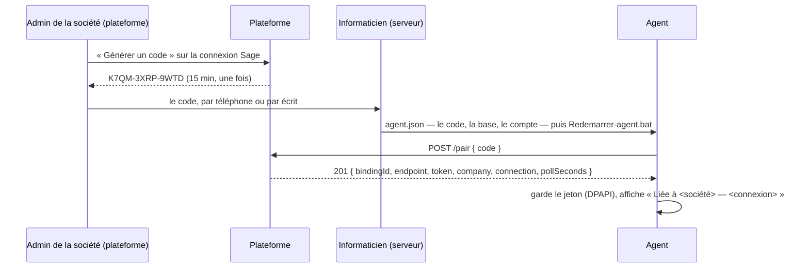
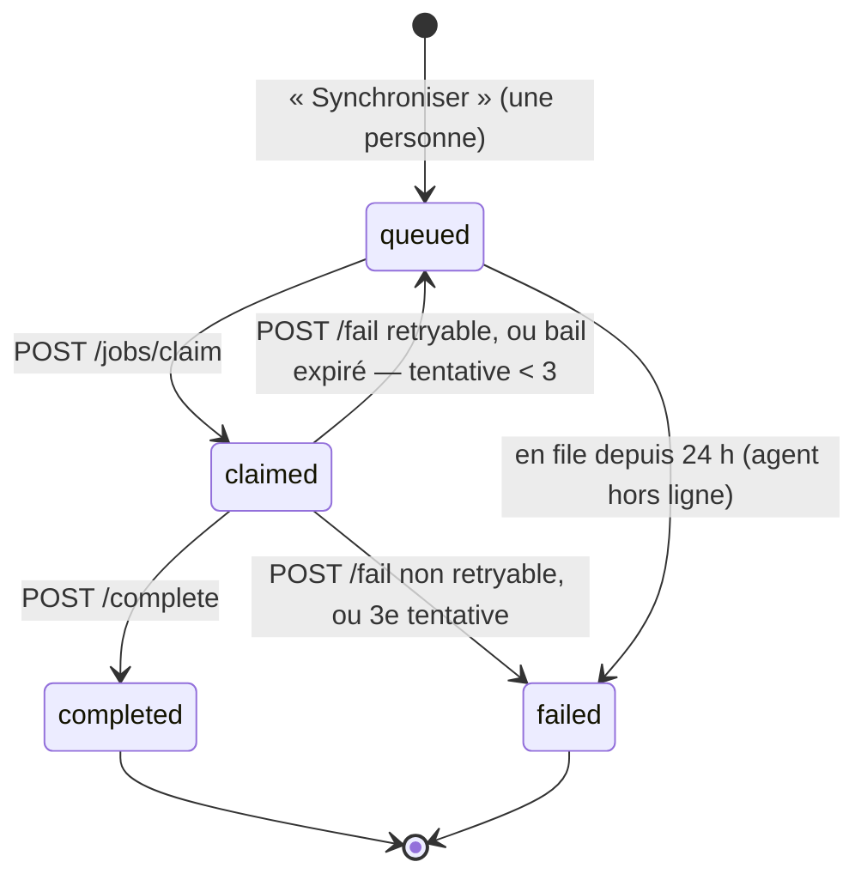
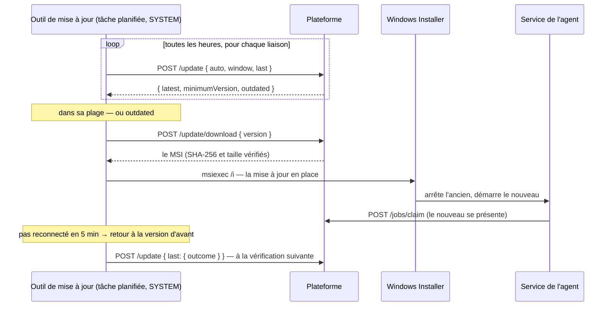

# The Sage agent protocol

> **v0 — draft.** Specified in Phase 3; **both sides are built** (Phase 4, the platform: `/api/agent`,
> `20261017100000_erp_agents.sql`, proven by `npm run smoke:agent`; Phases 5–6, the agent, proven end to
> end — 2026-10-17; Phase 9, the updates: `20261018100000_agent_updates.sql` — 2026-10-18). It stays v0 while the only agents installed are on the user's OWN servers (Phase 7
> tests on theirs), so a detail found wrong there is fixed here without a version; **v1 is the first
> frozen version**, declared before the first agent is installed on a CUSTOMER's server. From v1 on,
> every change is a new version (« Versioning »). *This said « before the first agent is installed
> anywhere else » until Phase 7 put one on the user's test server — loosened deliberately, that day.*
>
> The executable form is `packages/app-core/src/schemas/agent-protocol.ts` (Zod): the platform's
> router validates with it, and `schema/agent-protocol.schema.json` — what the agent reads — is
> generated from it. `fixtures/` holds one golden exchange per message at least. Where this page and
> the schema disagree, the schema is what runs: fix this page.

## Identity: the binding

The unit on the **platform** is the ERP connection of one société (`p_erp_connections`). On the
**server**, ONE agent runs per Windows server, whatever the number of SQL Server instances on it, and
hosts N **bindings**: one SQL Server database — on the instance the binding names, `SERVEUR\INSTANCE`
— ↔ one ERP connection of one société. *Until 2026-10-17 this read « one agent per instance »; the user
chose one agent for two instances on one server, which the agent already supported.*

- **[HARD] Every call is made AS ONE BINDING.** Pairing, token, heartbeat, job claim, job result —
  all per binding. The platform has no notion of « the instance » and no identifier shared across
  sociétés reaches it.
- **[HARD] A token never spans two bindings.** One token per binding, revocable, of which the
  platform stores only a hash.
- **[HARD] No call carries a list of databases**, or anything that tells one société what else the
  server hosts. The database of a binding is named locally, on the server, by the person who adds it.
- **[HARD] The ERP's credentials never reach the platform.** Each binding signs in to SQL Server its own
  way, stored on the server: **a SQL login** — any that can read the binding's `F_COMPTEG`, `sa`
  included (the user's decision of 2026-10-17, because the passation comptable will write into Sage) —
  **or Windows authentication** (the user, same day), where no password exists at all: the agent's
  SERVICE signs in as itself (`NT SERVICE\PayrollSageAgent` on its own machine, the machine account
  `DOMAINE\SERVEUR$` towards another server of a domain). Under Windows authentication **every binding
  of that agent shares one identity**, so what keeps a hosting company's clients apart is, again, the
  agent's code (it names its one database) and the rights IT grants that identity per database. The
  agent tells the person adding a binding what else its access can do; its CODE only reads in this slice.
- **Recommended, no longer required: a dedicated login DENIED `VIEW ANY DATABASE`.** Measured on SQL
  Server 2019 (Phase 2): a login with no right at all lists EVERY database of the instance through
  `sys.databases`, because `public` holds that permission; denied, it sees `master`, `tempdb` and its
  own database only, and still connects to its own. On an instance shared by several clients, that
  login is what keeps one client's books out of another binding's reach AT THE SQL LEVEL — with `sa`,
  the separation rests on the agent's code alone (it names its one database and never lists the
  others). The installation offers the script. *This line was [HARD] until 2026-10-17.*
- **One binding per connection.** Pairing a connection that already has a binding REPLACES it: the
  old token is revoked in the same transaction (a reinstall, a server move). The screen says so
  before the code is generated.
- **Only a Sage 100 connection** (`p_erp_connections.kind = 'sage100'`) can be paired; another kind
  is refused with `connection_not_sage`.

## Transport

| | |
| --- | --- |
| Base URL | **the agent's OWN address, not the web app's.** The platform states it (`NEXT_PUBLIC_AGENT_URL`; without it, the address called + `/api/agent`, where the web app serves it today); the screen shows it beside the pairing code, the agent pairs against it, and `PairResponse.endpoint` confirms it. **The agent uses `endpoint` for every later call** and keeps it with the binding. « The address called » is the one the AGENT wrote — its `Host` header, or `X-Forwarded-Host` / `-Proto` behind a relay — never the host the web server listens on |
| Scheme | **HTTP or HTTPS, to any host — for now, in development AND in production** (the user's decision, 2026-10-17). Over HTTP the pairing code, the bearer token and the chart cross the network in clear: whoever is on the path can read them, and replay the token until it is revoked. HTTPS comes later, and when it does the agent refuses `http://` again; `add-binding` meanwhile says so when it is given an `http://` address |
| Method | `POST` for every call, JSON body (`{}` when there is nothing to say), `Content-Type: application/json; charset=utf-8`. Every answer is JSON but ONE: `/update/download` answers the installer's bytes |
| Direction | always agent → platform. The customer opens no inbound port |
| Auth | `Authorization: Bearer igfa_…` on every call but `/pair` |
| Body limit | 5 MB — beyond it the request is refused before it is read (`result_too_large`); a chart of 10 000 accounts is about 1 MB |

**Why the address is its own (decided 2026-10-17).** It is written into every agent at every customer,
so changing it later would mean reconfiguring every server. In production it is a hostname dedicated
to agents (`agents.<domain>`), pointed today at the same server as the web app: moving the agent side
to a service of its own — which the platform keeps separable for that day — is then a DNS change, and
no installed agent notices.

**Every call carries**, `/pair` included:

| Header | Value |
| --- | --- |
| `X-Agent-Protocol` | the contract version the agent implements (`AgentProtocol.Version`), an integer |
| `X-Agent-Version` | the agent's own build version, `1.4.2` |
| `User-Agent` | `PayrollSageAgent/<build version>` |

**A tolerant reader on the agent's side, a strict one on the platform's.** A REQUEST with an unknown
key is refused (`request_invalid`): the platform is always the newer of the two, so an unknown key is
a bug. A RESPONSE may carry keys the agent does not know, and the agent ignores them: that is what
lets the platform add a field without breaking agents already installed.

### Routes

| Route | Body → answer | Refusals |
| --- | --- | --- |
| `POST /api/agent/pair` | `PairRequest` → `201 PairResponse` | `code_invalid`, `connection_not_sage`, `rate_limited` |
| `POST /api/agent/jobs/claim` | `ClaimRequest` → `200 ClaimResponse` | `token_invalid` |
| `POST /api/agent/jobs/complete` | `CompleteRequest` → `200 CompleteResponse` | `token_invalid`, `job_not_claimed` |
| `POST /api/agent/jobs/fail` | `FailRequest` → `200 FailResponse` | `token_invalid`, `job_not_claimed` |
| `POST /api/agent/unpair` | `UnpairRequest` → `204` | `token_invalid` |
| `POST /api/agent/offline` | `OfflineRequest` → `204` | `token_invalid` |
| `POST /api/agent/update` | `UpdateRequest` → `200 UpdateResponse` | `token_invalid` |
| `POST /api/agent/update/download` | `UpdateDownloadRequest` → `200` the MSI (`application/x-msi`) | `token_invalid`, `release_not_found` |

**Every route** may also answer `request_invalid` (400 — malformed JSON included) and `result_too_large`
(413). **The job routes and `/pair`** may answer `protocol_unsupported` (426) — a protocol out of the range
the platform serves — and `agent_outdated` (426) — a build version below the minimum the platform
publishes (« Updates »). On a route that carries a token, a 426 is answered AFTER the call is recorded:
the connection's screen shows the protocol and the version the agent spoke, and « agent à mettre à
jour ».

**[HARD] `/unpair`, `/offline`, `/update` and `/update/download` check NEITHER the protocol NOR the minimum
version.** They are the way out: an agent too old for everything else must still be able to let go of its
binding, say it is stopping, and find and fetch its replacement. So their request and response shapes only ever GROW — in every
version of this contract, for good.

**The job's id rides in the BODY** (`jobId`), never in the path — the platform's API has no nested path
parameters. A route is answered for the binding of the token only: a `jobId` of another binding is
`job_not_claimed`, exactly like a job that does not exist — never a different answer that would tell
one binding the other's jobs exist.

## Pairing



- **The code**: 12 characters from `ABCDEFGHJKMNPQRSTUVWXYZ23456789` (no 0/O, 1/I/L), shown as
  `XXXX-XXXX-XXXX` — 60 bits, readable over the phone. Valid **15 minutes**, **once**; generating a
  new code for a connection voids the previous unused one. The platform stores its hash only.
- **`code_invalid` is ONE answer** for a code that is unknown, expired or used — and for a société
  that is frozen (being deleted): several answers would tell an attacker which codes exist. Attempts are
  rate-limited (`rate_limited`) **globally, and per address where the platform can tell**: without a
  reverse proxy that overwrites `X-Forwarded-For`, the address is the client's own claim, so the global
  cap is the guard that holds.
- **The token**: `igfa_` + 32 random bytes, base64url. Shown to the agent ONCE in `PairResponse`,
  stored by the platform as a SHA-256 hash, by the agent machine-protected (DPAPI) — never in a
  config file in clear, never in a log. The prefix exists so a token pasted in a ticket is recognised
  and revoked.
- **`company.name` and `connection.name`** are returned so the person at the server sees which
  société they just linked — a code typed for the wrong client is caught there, before any sync.

## Polling and jobs

The agent asks; the platform never calls. **A claim is also the heartbeat**: the platform records,
per binding, `last_seen_at`, the protocol and the build version of the call.



| | |
| --- | --- |
| Poll interval | `pollSeconds` of the last answer (default **15 s**). The agent never polls faster; it may poll slower |
| Online / offline | « En ligne » while the last call is less than **45 s** old (three polls missed) — and the binding has not said `/offline` since — « Hors ligne » after. 120 s until 2026-10-18 |
| Stopping | **A service that stops calls `POST /offline` for each binding whose loop it ran**, AFTER the loops have ended — a claim still in flight that landed after it would put the binding back « En ligne ». Best effort: about 5 s for all of them together, never retried. A crash, a power cut or a network already down says nothing, and the 45 s of silence decide. The next call of any route that is a heartbeat makes the binding « En ligne » again |
| One job at a time | per connection (one binding per connection): a claim returns the claimable job of THAT binding, or `job: null`. « Synchroniser » is refused on the screen while a sync of that connection is queued or claimed |
| Lease | **300 s** from the claim (`leaseExpiresAt`). Not extended in v0/v1 — a sync of 10 000 accounts is seconds |
| Attempts | **3**. `attempt` is in the job and must be echoed in `complete` / `fail`: it is the FENCE. A late answer for an attempt whose lease expired and was re-queued is `job_not_claimed`, and changes nothing |
| Expiry | a job still `queued` after **24 h** fails as « agent hors ligne » — a sync clicked on Friday is not applied on Monday |
| Frozen société | a société being deleted hands out no job (`job: null`), and a result it receives writes nothing — the job fails `company_frozen` |

## Job types

| Type | Payload | Result | Status |
| --- | --- | --- | --- |
| `sync_gl_accounts` | `{}` | the whole chart of `F_COMPTEG` | specified |

### `sync_gl_accounts` — the chart of accounts, from Sage

**What the agent does — reads, maps, sends; it decides nothing.**

```sql
SELECT CG_Num, CG_Intitule, CG_Sommeil, CG_Type FROM dbo.F_COMPTEG  -- the binding's login; the agent only reads
```

| Contract field | From | Rule |
| --- | --- | --- |
| `number` | `CG_Num` | as read, trimmed (it is never padded in the measured data) |
| `label` | `CG_Intitule` | TRIMMED; empty or NULL is sent as `null` — the agent does not invent one |
| `dormant` | `CG_Sommeil` | `true` when not 0 |
| `sageType` | `CG_Type` | as read, the raw `smallint` |

The whole chart is sent in ONE `CompleteRequest` — at most **10 000** accounts, each number once; a
bigger chart fails the job as `source_invalid` with a sentence, it is not cut. `readAt` is when the
agent read it.

**What the platform does — decided by the user on 2026-10-17.** In ONE transaction, for the
connection of the binding, with the rules of `import_erp_accounts` for what they share:

| An account received… | The platform |
| --- | --- |
| with `sageType` ≠ 0 | **skips it** (`type_not_supported`). Other types are probably Sage « total » accounts, which take no entry — not confirmed: none existed in the measured company. Revisit when one is seen |
| with `label: null` | **skips it** (`label_missing`) — `p_gl_accounts.label` is required |
| whose label or number the platform refuses everywhere else (a control character, a leading `=` or `@`, a `+`/`-` not starting a number — `import_text_is_safe`) | **skips it** (`label_invalid` / `number_invalid`) |
| whose number is new on this connection | **creates** it, `is_active = not dormant` |
| whose number exists | updates the label when it differs; **`is_active` MIRRORS Sage**: dormant → deactivated, back from dormant → reactivated. A manual change of « désactivé » on a Sage connection is overwritten at the next sync, and the screen says so |
| — present on the platform, absent from Sage | **left as it is** (`absentFromSage` in the report), like the Excel import |

The result is **applied, then reported**: no draft, no confirmation step. `CompleteResponse.report`
counts every account received exactly once — `created`, `updated`, `unchanged` or `skipped` (listed
by number and reason) — with `deactivated` / `reactivated` as the part of `updated` whose active state
followed Sage. The screen shows it: « 412 créés, 3 mis à jour, 1 ignoré : sans intitulé dans Sage ».

#### The source, as measured (Phase 2, 2026-10-17)

Measured on a restored Sage 100 company (SQL Server 2019, `French_CI_AS`, 1 348 comptes). The full
shape of `F_COMPTEG` is in the agent repo (`docs/project-book/01-sage/f-compteg.md`); what the
contract must account for is this:

| Sage | Fact | What it means for the contract |
| --- | --- | --- |
| `CG_Num` `varchar(13)`, NOT NULL, unique | no padding, `[0-9A-Z]` only here | fits `p_gl_accounts.number` (text, 1–40) as is; it is the account's identity, as in `import_erp_accounts` |
| `CG_Intitule` `varchar(35)`, NULLABLE | **243 of 1 348 carry leading/trailing spaces**; 497 fill all 35 characters; 805 contain accents (code page 1252) | trimmed by the agent; `null` when empty; 35 characters is Sage's limit, not a truncation by the agent |
| `CG_Sommeil` `smallint` | only `0` observed | `dormant`; mirrored into `is_active` |
| `CG_Type` `smallint` | only `0` observed | `sageType`; anything but 0 is skipped until a real case is seen |
| `N_Nature` `smallint` | 0–14 observed | not sent. Sage stores no label for them (`P_NATURE` holds ranges and defaults, no names) |
| `CG_Tiers` `smallint` | `1` on 33 accounts | not sent — relevant to Compte tiers, a later job type |
| `cbMarq` `int`, primary key | Sage's own row id | not sent: whether it survives a renumbering is not measured; the identity is `CG_Num` |
| `cbModification` `datetime`, never NULL here | last change of the row | not used yet — it would allow an incremental sync, a later, additive change |

## Failures — what the platform records itself

The agent never sends these; the screen shows them on the job:

| `error_code` | When |
| --- | --- |
| `agent_offline` | queued for 24 h without a claim |
| `too_many_attempts` | the lease expired three times |
| `binding_revoked` | the binding was revoked, replaced or unpaired while the job was open |
| `company_frozen` | the société is being deleted: nothing was written |

## Failures — what the agent reports (`FailRequest`)

| `error.code` | When | `retryable` |
| --- | --- | --- |
| `sql_unreachable` | the SQL Server does not answer (network, service stopped, timeout to connect) | yes |
| `sql_timeout` | a query ran past its command timeout (30 s) | yes |
| `sql_login_failed` | the binding's SQL login is refused (password changed, login disabled) | no — a person must fix the binding |
| `sql_permission_denied` | the login cannot read what the job needs | no |
| `source_invalid` | what Sage holds cannot be expressed in the contract (two identical numbers, more than 10 000 accounts) | no |
| `internal` | anything else — a bug in the agent | yes, the platform's attempt count stops it |

`error.message` is ONE French sentence, at most 500 characters, that the screen shows as is: what
went wrong and, when it can, what to do. **Never a password, a token, a connection string, a stack
trace or a row of Sage** — the detail stays in the agent's local log. A retryable failure re-queues
the job with a delay (`FailResponse.outcome = retry_scheduled`) until the third attempt.

## Errors — what the platform refuses (`ErrorResponse`)

Every 4xx carries `{ "error": { "code", "message", … } }`; `message` is French and can be shown. A
5xx carries nothing the agent should read (the platform's generic `internal_error`).

| `code` | HTTP | The agent |
| --- | --- | --- |
| `request_invalid` | 400 | the body broke the contract — an unknown key, a wrong type, malformed JSON. A bug on one side: logs it, fails the job if there is one, does not retry the same body |
| `token_invalid` | 401 | the binding is unknown or REVOKED: stops that binding, marks it « révoquée » locally, keeps polling the others |
| `code_invalid` | 404 | pairing refused: says the sentence to the person at the server |
| `job_not_claimed` | 409 | its answer came too late or for another binding's job: drops it, claims again |
| `result_too_large` | 413 | fails the job as `source_invalid` |
| `connection_not_sage` | 422 | pairing refused: the code was made for a connection that is not Sage 100 |
| `protocol_unsupported` | 426 | carries `protocol` and `minimumSupported`: the agent says « agent à mettre à jour », keeps the binding, retries every hour |
| `agent_outdated` | 426 | carries `minimumVersion`: this BUILD is below the minimum the platform publishes. The agent keeps the binding, calls again every 5 minutes (so the screen still sees it), and its updater installs the latest version at its next run, without waiting for its window |
| `release_not_found` | 404 | the version asked for is not published, or was withdrawn: the agent checks again (`/update`) at its next run |
| `rate_limited` | 429 | waits `retryAfterSeconds` (also in `Retry-After`) |

## Timeouts and backoff (agent side)

| | |
| --- | --- |
| HTTP request | 30 s |
| SQL connect / command | 15 s / 30 s |
| Network error or 5xx | retry with exponential backoff, 5 s doubling to 5 min, with jitter; the binding shows « hors ligne » on the platform meanwhile |
| Concurrent SQL queries | a global cap across bindings: the server is shared, the agent is a guest |

## A Sauvegarde restore keeps the binding

Decided 2026-10-17. Restoring a Sauvegarde deletes and re-inserts every ERP connection of the
société; the restore keeps the binding and its token for each Sage 100 connection that still exists
afterwards, so the agent goes on working without a visit to the server. A restore is refused while a
job of the société is queued or claimed; an open pairing code does not survive it (generate another).

## Revocation and unpairing

- **On the platform**, « Révoquer » sets the binding revoked at once; its next call is
  `token_invalid`.
- **On the server**, `remove-binding` calls `POST /unpair` with the binding's token (best effort),
  which revokes it, and then deletes the binding's local config and secrets. When the platform cannot
  be reached, the binding is removed locally anyway and the screen keeps showing it until someone
  revokes it there — and says « hors ligne depuis … » so the gap is visible.

## Versioning

Decided 2026-10-17 (plan › O7).

- `version.json` › `protocol` is the version of this contract, an integer. `minimumSupported` is the
  oldest agent protocol the platform still serves; `minimumSupported ≤ protocol`.
- **Every agent call carries the agent's protocol version and its own build version** —
  `X-Agent-Protocol` and `X-Agent-Version` (« Transport »).
- **Changes are additive where possible.** An additive change bumps `protocol` and leaves
  `minimumSupported` where it is: older agents keep working. A new optional key in a RESPONSE is
  additive (tolerant reader); a new key in a REQUEST is additive only if the platform keeps accepting
  requests without it.
- **A breaking change** bumps `protocol`; `minimumSupported` is raised only after the agent that
  speaks the new version has been released and a fixed window has passed. *Window length: set at the
  first release.*
- **The platform enforces the minimum per binding.** A call below it is `protocol_unsupported`, and
  the connection's screen shows « agent à mettre à jour ».
- **A second floor, on the BUILD: the minimum version** (`sys_agent_releases.is_minimum`, set when a
  release is published with `--minimum`). It is for a defect in an agent rather than a change of
  contract: a call from a build below it is `agent_outdated`, the screen says « agent à mettre à jour »,
  and the agent's updater installs the latest at once. The two floors are independent; the way-out
  routes check neither.
- Mechanically (`check:agent-protocol`): while `protocol` is 0 nothing ships and a change needs no
  bump; from 1 on, any change to the contract files is a new version, with its CHANGELOG entry.

## Distribution

Decided 2026-10-17 (plan › O6); specified 2026-10-18 (Phase 9).

- **One generic installer for every customer**: the MSI carries no token, no code and no customer data.
  The binding's config (platform URL, one-time pairing code) is `agent.json`, in the agent's folder —
  the screen hands the entry to paste into it, with the code filled in.
- **The installers are kept in the private Storage bucket `agent-releases`**, at
  `<version>/PayrollSageAgent-<version>-x64.msi`, and described by `sys_agent_releases` — version,
  protocol, SHA-256, size, signed or not, published / withdrawn, minimum or not. No binary is committed
  to `igf_payroll`. They are put there by the operator, `npm run agent:publish`, from the agent repo's
  `dist/` (its `release.json`); the platform publishes only a version whose protocol it serves.
- **A person downloads it from the agent's screen**, with `Accounting.Setup.Update`, through a signed
  URL of one minute; each download is logged in `sys_events` (the version, the connection, the person).
  An unsigned build is shown « Version de développement, non signée ».
- **The agent fetches it with a binding's token** — the two routes below.

## Updates

Specified 2026-10-18 (Phase 9). The agent installs a new version by itself, in a window of hours its
administrator chooses, or at once when the platform refuses its version.



- **`POST /api/agent/update`**, every hour, ONCE PER BINDING (each with its own token): the agent says
  whether it updates itself (`auto`), its window (`"03:00-05:00"`, the SERVER's clock, possibly across
  midnight), and its LAST attempt — version, outcome (`updated`, `failed`, `rolled_back`,
  `reboot_pending`), when, and one French sentence. The platform records them on the binding (its screen
  shows them) and answers the latest published version, the minimum, and whether THIS agent is below it.
  **It is not a heartbeat**: the updater runs beside the service, and a stopped service must still read
  « hors ligne ».
- **`POST /api/agent/update/download`** `{ version }` answers `200` with the MSI's bytes:
  `Content-Type: application/x-msi`, `Content-Length`, and `X-Agent-Release-SHA256`. **The agent trusts
  `UpdateResponse.latest.sha256` and `.bytes`**, not the header, and refuses a file that differs. A
  version not published, or withdrawn, is `release_not_found`.
- **When the agent installs** — decided by the agent, reported in `UpdateRequest`: `outdated` → at once;
  `auto` and the server's clock inside `window` → then; otherwise never on its own (« Mettre à jour
  maintenant » is a person's gesture on the server). A version that failed is not tried again for
  20 hours.
- **What the platform relies on**: a signed agent installs only a signed MSI (`signed: true`) of the same
  publisher; an unsigned one checks the SHA-256 only — over HTTP, an update is exactly as trustworthy
  as the channel (« Transport »).

## The machine-readable form

| File | What |
| --- | --- |
| `packages/app-core/src/schemas/agent-protocol.ts` | the Zod source: every message, the closed lists (`AGENT_JOB_TYPES`, `AGENT_ERROR_CODES`, `AGENT_JOB_ERROR_CODES`, `SYNC_SKIP_REASONS`, `UPDATE_OUTCOMES`), `AGENT_LIMITS`, `AGENT_HEADERS`, `AGENT_DOWNLOAD` |
| `schema/agent-protocol.schema.json` | GENERATED (JSON Schema 2020-12, one `$defs` entry per message) by `npm run check:agent-protocol -- --freeze`; never edited |
| `fixtures/<Message>[.<case>].json` | golden bodies. `check:agent-protocol` parses each as its message and demands one per message; the agent's tests deserialize and re-serialize every one. Tokens in them carry `EXAMPLE`, data is fictional |
